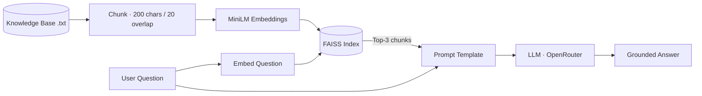

<div align="center">

# 💬 RAG-Based Knowledge Chatbot

**A Retrieval-Augmented Generation chatbot that answers questions from a custom knowledge base — instead of guessing.**


</div>

---

## 📌 Overview

Large Language Models are fluent but can hallucinate facts they were never trained on.
This chatbot solves that with **RAG**: it searches a domain-specific knowledge base, retrieves the most
relevant passages and passes them to the LLM as context, so every answer is grounded in real information.

The included knowledge base covers **Al-Balqa Applied University and its Faculty of Artificial
Intelligence**, and it can be replaced with any text document.

## ✨ Features

- Loads and processes a custom text knowledge base
- Splits documents into overlapping chunks for precise retrieval
- Generates semantic embeddings with `sentence-transformers/all-MiniLM-L6-v2`
- Indexes embeddings in a **FAISS** vector store for fast similarity search
- Retrieves the top-3 most relevant chunks for each question
- Builds a context-aware prompt and generates the answer with an LLM via **OpenRouter**
- Interactive command-line chat loop

## 🏗️ How It Works



## 🧰 Tech Stack

| Component | Technology |
|---|---|
| Orchestration | LangChain |
| Embeddings | Hugging Face · all-MiniLM-L6-v2 |
| Vector store | FAISS |
| LLM access | OpenRouter (OpenAI-compatible API) |
| Language | Python |

## 📂 Project Structure

```text
├── app.py          # Chat loop: retrieve → prompt → answer
├── RAG.py          # Loading, chunking, embeddings and FAISS retriever
├── llm_model.py    # LLM configuration (OpenRouter)
├── prompts.py      # RAG prompt template
└── balqa_ai.txt    # Knowledge base
```

## 🚀 Getting Started

```bash
git clone https://github.com/Ammarjm/RAG-Based-Chatbot.git
cd RAG-Based-Chatbot

pip install langchain langchain-community langchain-huggingface langchain-openai \
            langchain-text-splitters faiss-cpu sentence-transformers python-dotenv
```

Create a `.env` file with your OpenRouter credentials:

```env
openrouter_API_KEY=your_api_key
openrouter_API_URL=https://openrouter.ai/api/v1
```

Run the chatbot:

```bash
python app.py
```

Type your question, or `exit` to quit.

## 🔮 Future Improvements

- Web interface with Streamlit or FastAPI
- Support for PDF and multi-document knowledge bases
- Source citations in every answer
- Retrieval evaluation (precision@k, answer faithfulness)

## 👤 Author

**Ammar Alsabateen** — AI & Machine Learning Engineer
[GitHub](https://github.com/Ammarjm) · [Email](mailto:alsabateenammar@gmail.com)
